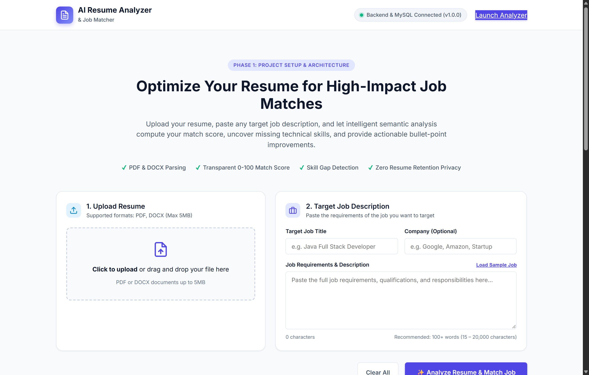
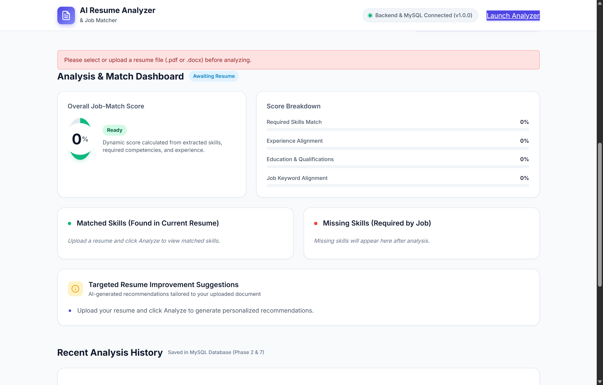
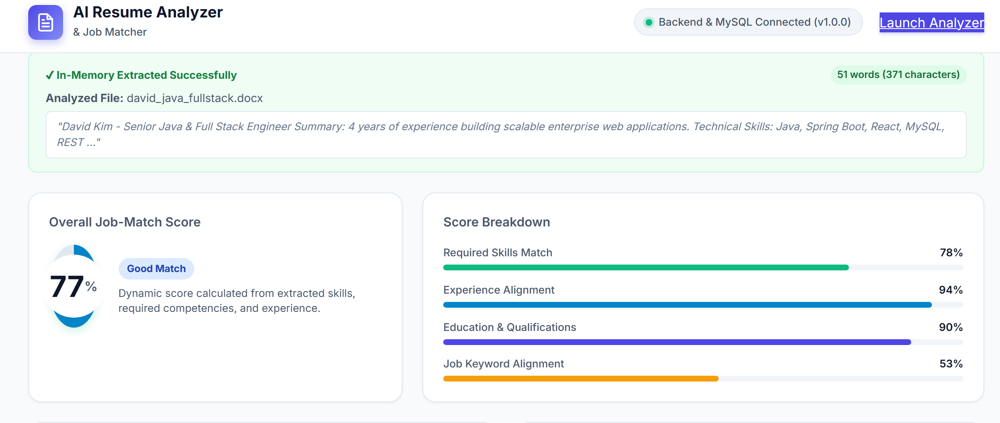
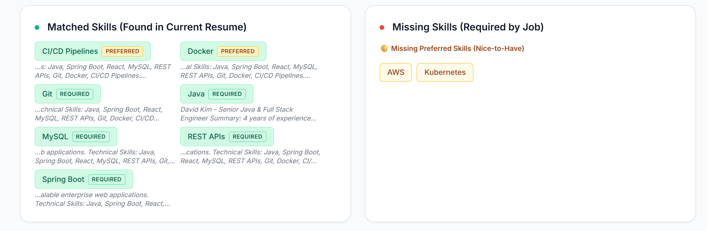
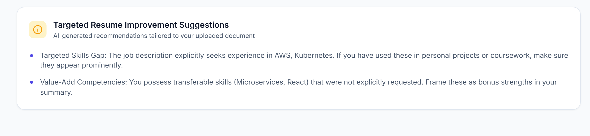
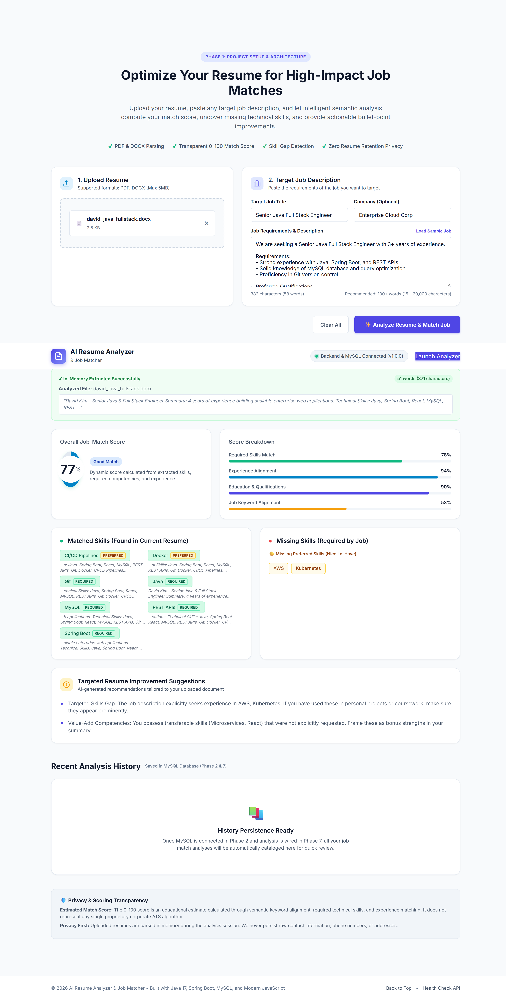

# AI Resume Analyzer & Job Matcher

[](https://www.oracle.com/java/technologies/javase/jdk17-archive-downloads.html)
[](https://spring.io/projects/spring-boot)
[](https://www.mysql.com/)
[](LICENSE)
[]()

A full-stack, privacy-centric web application designed to evaluate candidate resumes against target job postings. Powered by Spring Boot 3, Apache PDFBox, Apache POI, and modern JavaScript, the application performs in-memory document parsing, dynamic skill extraction, required vs. preferred competency classification, explainable multi-factor scoring, and targeted resume optimization recommendations.

---

## Table of Contents

- [Overview & Purpose](#overview--purpose)
- [Application Screenshots](#application-screenshots)
- [Key Features](#key-features)
- [System Architecture](#system-architecture)
  - [Request & Data Flow](#request--data-flow)
- [Technologies Used](#technologies-used)
- [Prerequisites](#prerequisites)
- [Step-by-Step Setup Guide (Windows)](#step-by-step-setup-guide-windows)
  - [1. Clone / Extract Repository](#1-clone--extract-repository)
  - [2. Configure MySQL Database](#2-configure-mysql-database)
  - [3. Configure Application Properties](#3-configure-application-properties)
  - [4. Build and Run Application](#4-build-and-run-application)
- [Accessing the Application](#accessing-the-application)
- [API Endpoints Reference](#api-endpoints-reference)
  - [POST /api/analyze](#post-apianalyze)
  - [GET /api/health](#get-apihealth)
  - [GET /api/db-check](#get-apidb-check)
- [Running Automated Tests](#running-automated-tests)
- [Privacy & Security Guarantee](#privacy--security-guarantee)
- [Known Limitations](#known-limitations)

---

## Overview & Purpose

Job seekers frequently struggle to tailor their resumes to modern applicant tracking criteria, while technical screeners require transparent evidence of a candidate's qualifications. 

**AI Resume Analyzer & Job Matcher** bridges this gap by providing:
- **Instant Document Ingestion**: In-memory text extraction from PDF and DOCX files.
- **Context-Aware Skill Extraction**: Advanced regex pattern matching that prevents false-positive hits (such as distinguishing `REST APIs` from `rest`, or `React` framework from the English verb `react`).
- **Required vs. Preferred Classification**: Clear partitioning between non-negotiable requirements and "nice-to-have" skills based on job description sections and phrases.
- **Verbatim Evidence Snippets**: Exact text quotes extracted from the resume showing where each matched skill was demonstrated.
- **Explainable Match Scoring**: A transparent score between 15% and 98% calculated across 4 explicit weighted dimensions.

---

## Application Screenshots

| Main Dashboard & Upload Area | Input Validation Error Handling |
| :---: | :---: |
|  |  |

| Match Score & Multi-Factor Breakdown | Required vs. Preferred Skills with Evidence |
| :---: | :---: |
|  |  |

| Targeted Optimization Suggestions | Complete Results Dashboard |
| :---: | :---: |
|  |  |

---

## Key Features

- **Multi-Format In-Memory Parsing**:
  - Supports `.pdf` documents via **Apache PDFBox 3.0.3**.
  - Supports `.docx` documents via **Apache POI 5.2.5** (`poi-ooxml`).
  - Validates document binary headers (magic numbers `%PDF` and `PK\x03\x04`) to prevent corrupted or renamed file uploads.
- **Comprehensive 40+ Skill Catalog**:
  - Covers Languages, Frameworks, Cloud, Databases, DevOps, Testing, and Architecture.
  - Safe boundary patterns prevent false positives (e.g., `Node.js`, `Express.js`, `Next.js`, `REST APIs`, `CI/CD Pipelines`, `Unit Testing JUnit/Mockito`).
- **Required vs. Preferred Skill Buckets**:
  - Scans job descriptions for explicit headings (e.g., `Requirements:`, `Must Have:`, `Minimum Qualifications:`) versus preferred indicators (`Preferred:`, `Nice to have:`, `Bonus:`, `Strong plus`).
  - Separates matched and missing skills into distinct UI sections.
- **Authentic Evidence Extraction**:
  - Extracts the exact sentence or bullet point from the resume that proves skill proficiency.
  - Returns `"Evidence not found"` rather than hallucinating or guessing evidence.
- **Transparent Multi-Factor Scoring Formula**:
  - **50% Required Skills Match**: Ratio of matched job skills to total job skills.
  - **20% Keyword Alignment**: Frequency and density of job domain terms across the resume.
  - **15% Experience Alignment**: Explicit experience duration comparison between candidate history and job requirements.
  - **15% Education Alignment**: Detection of accredited degree qualifications (Bachelor's, Master's, PhD, Computer Science, etc.).
  - Scores are normalized and bounded between **15% and 98%**.
- **Actionable Optimization Recommendations**:
  - Dynamically synthesizes prioritized suggestions addressing missing required skills, experience gaps, and formatting optimizations.
- **Modern, Accessible UI**:
  - Drag-and-drop file upload with animated file metadata badge.
  - Dynamic job description character counter (15 to 20,000 characters limit).
  - One-click "Load Sample Job" button for rapid testing.
  - SVG conic-gradient score gauge.
  - Built-in screen reader support (`role="alert"`, `aria-live`, accessible keyboard controls).
  - "Clear All" action resetting all form inputs and analysis dashboards.
  - Live backend and MySQL connectivity indicator.

---

## System Architecture

The application adopts a clean, layered Spring Boot client-server architecture:

```
[ Web Browser ]
   │
   ├─► Static Frontend (index.html / styles.css / app.js)
   │
   ▼
[ Spring Boot Embedded Tomcat (:8080) ]
   │
   ├──► HealthController (/api/health, /api/db-check)
   │        │
   │        └──► MySQL Database (DataSource Ping & Validation)
   │
   └──► ResumeAnalysisController (/api/analyze)
            │
            ├──► ResumeParserService (In-Memory PDFBox / POI)
            │        └── Stream bytes -> Raw Text (No Disk Write)
            │
            └──► AnalysisService
                     ├── Dynamic Skill Extractor (Regex Dictionary)
                     ├── Job Requirement Classifier (Required vs Preferred)
                     ├── Evidence Snippet Locator (Verbatim Text Search)
                     ├── Multi-Factor Scorer (50/20/15/15 Formula)
                     └── Targeted Recommendation Generator
```

### Request & Data Flow

1. The candidate uploads a resume file (`PDF` or `DOCX`) and enters a job description ($\ge 15$ characters).
2. The browser submits a `multipart/form-data` request to `POST /api/analyze`.
3. `ResumeAnalysisController` verifies file integrity, file size ($\le 5\,\text{MB}$), and job description length ($\le 20,000$ characters).
4. `ResumeParserService` inspects file signatures and extracts plain text directly from the byte stream in memory.
5. `AnalysisService` evaluates skills, classifies requirements, checks experience, compiles evidence snippets, and computes weighted scores.
6. A JSON `AnalysisResponseDto` is returned to the browser, and `app.js` updates the interactive dashboard.

---

## Technologies Used

### Backend
- **Java**: Version 17
- **Framework**: Spring Boot 3.3.4
  - `spring-boot-starter-web`: REST endpoints & Embedded Tomcat
  - `spring-boot-starter-validation`: Parameter and payload validation
  - `spring-boot-starter-data-jpa`: Hibernate ORM and database management
  - `spring-boot-devtools`: Hot reload during development
- **Document Extractors**:
  - **Apache PDFBox 3.0.3**: In-memory PDF text extraction
  - **Apache POI 5.2.5** (`poi-ooxml`): In-memory Microsoft Word (`.docx`) text extraction
- **Database Driver**: MySQL Connector/J (`mysql-connector-j`)
- **Testing**: JUnit 5, Spring Boot Starter Test, AssertJ

### Frontend
- **HTML5**: Semantic tags, accessible forms, ARIA live-regions
- **CSS3**: Modern CSS variables, Grid, Flexbox, responsive design, SVG animations
- **JavaScript**: Native ES6+ (Fetch API, Async/Await, DOM manipulation, no heavy frontend frameworks required)
- **Typography**: Google Fonts (*Inter*)

### Database
- **MySQL Server 8.0+**

---

## Prerequisites

Before setting up the project, ensure you have the following installed:

1. **Java Development Kit (JDK) 17**:
   - Verify by running:
     ```powershell
     java -version
     ```
2. **MySQL Server 8.0+**:
   - Ensure the MySQL service is running locally on port `3306`.
3. **Apache Maven 3.8+** *(Optional)*:
   - A Maven wrapper (`mvnw.cmd`) and local portable Maven binaries (`.tools\apache-maven-3.9.6`) are included with the project.
4. **Modern Web Browser**:
   - Google Chrome, Microsoft Edge, Mozilla Firefox, or Safari.

---

## Step-by-Step Setup Guide (Windows)

### 1. Clone / Extract Repository

Open PowerShell or Command Prompt and navigate to your workspace:
```powershell
cd "c:\Users\sachi\OneDrive\Desktop\AI Resume Analyzer & Job Matcher"
```

### 2. Configure MySQL Database

Log in to your local MySQL instance:
```powershell
mysql -u root -p
```

Create the application database:
```sql
CREATE DATABASE IF NOT EXISTS ai_resume_analyzer;
SHOW DATABASES;
EXIT;
```

### 3. Configure Application Properties

The application separates public base configurations (`application.properties`) from sensitive local credentials (`application-local.properties`).

> [!IMPORTANT]
> `src/main/resources/application-local.properties` is ignored by Git in `.gitignore` to prevent secret leakage.

Create or update `src/main/resources/application-local.properties` with your local database credentials:

```properties
# =========================================================================
# Local MySQL Database Configuration
# =========================================================================

# Database Connection Settings
spring.datasource.url=jdbc:mysql://localhost:3306/ai_resume_analyzer?useSSL=false&serverTimezone=UTC&allowPublicKeyRetrieval=true
spring.datasource.username=YOUR_MYSQL_USERNAME
spring.datasource.password=YOUR_MYSQL_PASSWORD
spring.datasource.driver-class-name=com.mysql.cj.jdbc.Driver

# JPA / Hibernate Configuration
spring.jpa.hibernate.ddl-auto=update
spring.jpa.show-sql=false
spring.jpa.properties.hibernate.format_sql=false
spring.jpa.open-in-view=false
```

*Replace `YOUR_MYSQL_USERNAME` and `YOUR_MYSQL_PASSWORD` with your MySQL credentials.*

### 4. Build and Run Application

#### Option A: Using the Windows Startup Script
Run the pre-configured batch script from the project root:
```cmd
run.bat
```

#### Option B: Using Maven Wrapper
```powershell
.\mvnw.cmd spring-boot:run
```

#### Option C: Using Local/Installed Maven
```powershell
mvn spring-boot:run
```

Once started, the terminal will display:
```
==================================================================
 AI Resume Analyzer & Job Matcher started successfully!
 Open your browser and navigate to: http://localhost:8080
 Health check endpoint: http://localhost:8080/api/health
==================================================================
```

---

## Accessing the Application

1. Open your browser and navigate to:
   ```
   http://localhost:8080
   ```
2. Verify the status pill in the navigation header displays:
   `Backend & MySQL Connected (v1.0.0)` with a green indicator dot.
3. Test with sample resumes located in the project's `test-resumes/` directory:
   - `test-resumes/alex_java_developer.pdf`
   - `test-resumes/david_java_fullstack.docx`
   - `test-resumes/sarah_python_cloud.pdf`
4. Click **Load Sample Job** to populate a sample job posting, then click **Analyze Resume**.

---

## API Endpoints Reference

### POST `/api/analyze`
Submits a resume document and target job description for dynamic matching.

- **Request Type**: `multipart/form-data`
- **Parameters**:
  - `file` (*MultipartFile*, required): Resume file in `.pdf` or `.docx` format ($\le 5\,\text{MB}$).
  - `jobDescription` (*String*, required): Text of the target job posting ($15$ to $20,000$ characters).
  - `jobTitle` (*String*, optional): Job title for context.
  - `company` (*String*, optional): Company or hiring organization name.

- **Success Response (200 OK)**:
```json
{
  "fileName": "david_java_fullstack.docx",
  "resumeCharCount": 371,
  "resumeWordCount": 54,
  "resumeSnippet": "David Kim - Full Stack Developer Experience with Java, Spring Boot, React, MySQL...",
  "matchScore": 96,
  "rating": "Strong Match",
  "scoreBreakdown": {
    "Required Skills Match": 100,
    "Experience Alignment": 90,
    "Education & Qualifications": 85,
    "Job Keyword Alignment": 95
  },
  "skillsClassified": true,
  "requiredMatchedSkills": ["Java", "MySQL", "Spring Boot"],
  "missingRequiredSkills": [],
  "preferredMatchedSkills": ["Docker", "Git"],
  "missingPreferredSkills": ["AWS"],
  "matchedSkills": ["Docker", "Git", "Java", "MySQL", "Spring Boot"],
  "missingSkills": ["AWS"],
  "additionalSkills": ["CI/CD Pipelines", "React"],
  "skillEvidence": {
    "Java": "Over 4 years of professional experience building enterprise applications with Java and Spring Boot.",
    "Spring Boot": "Architected microservices leveraging Spring Boot and Spring Data JPA.",
    "MySQL": "Managed relational database schemas and queries in MySQL."
  },
  "recommendations": [
    "Consider adding experience with AWS to strengthen alignment with preferred qualifications."
  ],
  "analyzedAt": "2026-10-15T13:45:00"
}
```

- **Error Response (400 Bad Request)**:
```json
{
  "status": "BAD_REQUEST",
  "message": "Please provide a meaningful job description (at least 15 characters)."
}
```

---

### GET `/api/health`
Health check endpoint reporting application and database connectivity.

- **Success Response (200 OK)**:
```json
{
  "status": "UP",
  "message": "AI Resume Analyzer Backend is running smoothly!",
  "version": "1.0.0",
  "database": "CONNECTED",
  "timestamp": "2026-10-15T13:45:00"
}
```

---

### GET `/api/db-check`
Performs an active SQL query (`SELECT DATABASE(), VERSION(), 1`) against MySQL to diagnose connection parameters.

- **Success Response (200 OK)**:
```json
{
  "status": "SUCCESS",
  "database": "ai_resume_analyzer",
  "mysqlVersion": "8.0.46",
  "queryVerification": "Ping test query returned: 1",
  "message": "Spring Boot is successfully connected to MySQL database: ai_resume_analyzer",
  "timestamp": "2026-10-15T13:45:00"
}
```

---

## Running Automated Tests

The application includes an extensive test suite verifying in-memory document parsing, regex boundaries, experience alignment, required/preferred classification, input validation, and end-to-end integration contracts.

Run the test suite using Maven:

```powershell
.\mvnw.cmd test
```
Or with portable Maven:
```powershell
& ".\.tools\apache-maven-3.9.6\bin\mvn.cmd" test
```

### Test Suite Execution Summary
- **Test Class**: `com.resume.analyzer.ResumeAnalysisTest`
- **Total Tests**: **48**
- **Test Results**: **48 Passed, 0 Failures, 0 Errors, 0 Skipped**

### Tested Scenarios
1. **Valid PDF Ingestion**: Text extraction, skill matching, and scoring with PDF files.
2. **Valid DOCX Ingestion**: Microsoft Word document unpacking and analysis.
3. **Document Rejection**: Detection of invalid extensions, empty files, corrupted file headers, and files exceeding $5\,\text{MB}$.
4. **Job Description Validation**: Rejection of empty, whitespace-only, too-short ($< 15$ chars), and oversized ($> 20,000$ chars) postings.
5. **State Isolation**: Sequential requests (e.g., failed attempt followed by valid retry) execute with clean in-memory state.
6. **Fresh Analysis Isolation**: Different resumes evaluated consecutively maintain complete result separation.
7. **Skill & Evidence Verification**: Exact sentence extraction without hallucinated evidence.
8. **Contract Integrity**: Health and database diagnostic endpoints match client expectations.

---

## Privacy & Security Guarantee

The application is engineered with a **Zero Retention Policy**:
- **In-Memory Text Parsing Only**: Uploaded files are converted directly into byte arrays, processed via memory streams (`ByteArrayInputStream`), and stripped of text in RAM.
- **No Disk Persistence**: Resumes are never saved to temporary directories or filesystem storage.
- **No Database Persistence of Content**: Extracted resume text and personal candidate data are never written to MySQL tables.
- **Immediate Garbage Collection**: Memory references are de-referenced once the response payload is transmitted.

---

## Known Limitations

- **Scanned / Image-Only PDFs**: Resumes that consist solely of scanned raster images without an embedded text layer cannot be parsed by Apache PDFBox. Users must provide documents with selectable, copyable text.
- **Encrypted / Password-Protected Files**: Password-protected PDFs are rejected by the parser for security and processing integrity.
- **Legacy Word Format (.doc)**: Only modern OpenXML Word documents (`.docx`) are supported; legacy binary `.doc` (Word 97–2003) files must be converted before upload.
- **Maximum File Size**: Resumes are limited to $5\,\text{MB}$.
- **Job Description Bounds**: Job postings must contain between $15$ and $20,000$ characters.
